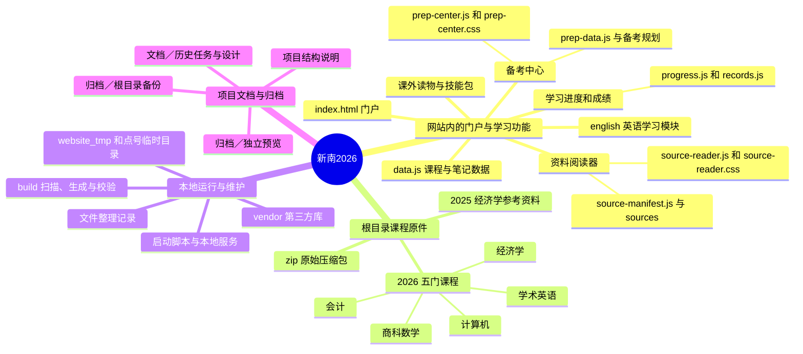

# 学习小屋网站架构思维导图

| 文件类别 | 位置 |
| --- | --- |
| 当前入口与站点路径约定 | [项目结构说明](项目结构说明.md) |
| 需求、任务提示词和 UI 设计稿 | `文档/历史任务与设计/` |
| 原来散落在根目录的历史备份 | `归档/根目录备份/` |
| 会计笔记样稿及 SDG 11 翻译预览 | `归档/独立预览/` |

课程资料的原目录名是站内链接的一部分。扫描脚本生成 `build/file_index.json`，数据构建脚本再据此生成门户使用的 `data.js`。课程原件统一存放在上一级 `新南2026/`。本地服务通过原课件 URL 读取外层文件，构建输出仍留在 `网站/`。
